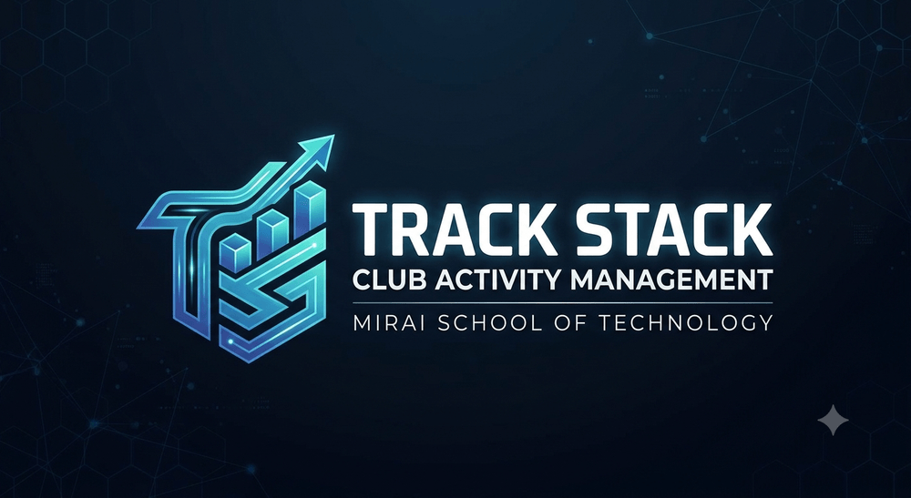
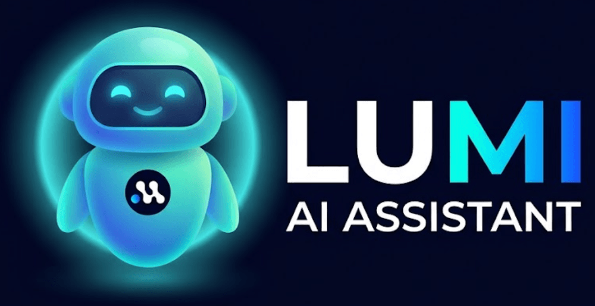
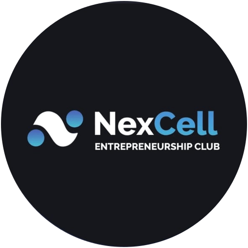
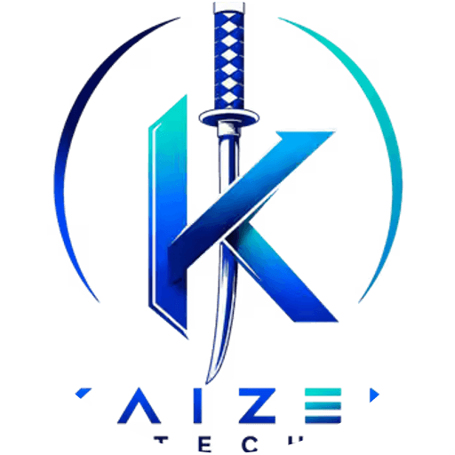
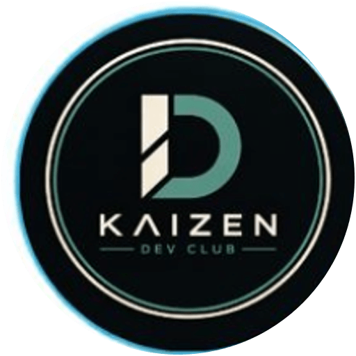
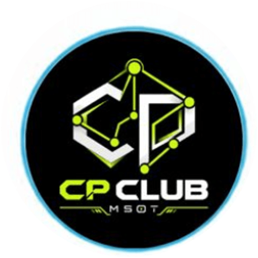
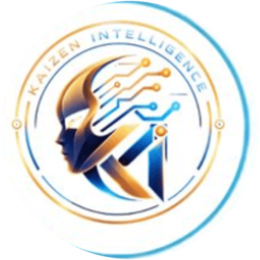
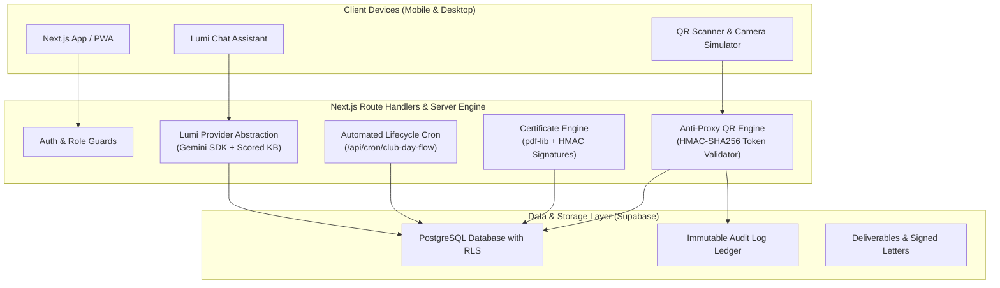

<p align="center">
  
</p>

<p align="center">
  <strong>Club Activity Management for Mirai School of Technology (MSOT)</strong>
</p>

<p align="center">
  <a href="https://nextjs.org"></a>
  <a href="https://www.typescriptlang.org"></a>
  <a href="https://supabase.com"></a>
  <a href="https://tailwindcss.com"></a>
  <a href="https://vercel.com"></a>
  <a href="./LICENSE"></a>
  <a href="#built-with-ai"></a>
</p>

---

## Built with AI

> [!IMPORTANT]
> **Track Stack was built with the help of AI.** The developer is a first-year B.Tech CSE student with a strong foundation in HTML and CSS. The application code, database schema, security rules, and documentation were generated using **Google Antigravity** and advanced AI models under the developer's continuous direction and oversight.
> 
> The developer defined the product requirements from the official Mirai School of Technology (MSOT) brief, selected the feature roadmap, curated the club logos and branding assets, reviewed the generated output line-by-line, executed end-to-end testing, and iterated with the AI pairing assistant. This project represents both a functional production system and an intensive learning journey, where the developer is actively dissecting and mastering how each architecture layer operates under the hood.

### What This Project Demonstrates
- **Directing AI Engineering Tools**: Translating high-level educational institution specifications into precise system designs, schema constraints, and secure workflows.
- **Product Architecture & Thinking**: Defining user roles, access control boundaries, anti-tamper mechanisms, and intuitive real-world UX for both mobile and desktop.
- **Verification & Review**: Enforcing strict testing discipline, cryptographic validation, zero-trust RLS policies, and regression auditing on AI-generated code.

---

## Overview

Club data in modern educational institutions is historically fractured across ephemeral WhatsApp group chats, ad-hoc Google Forms, and disconnected spreadsheets. Attendance is vulnerable to proxy signing, evaluation feedback is lost, certificates are forged or unverified, and students graduate without an official, tamper-proof record of their co-curricular achievements.

**Track Stack** solves this by unifying college club administration into a single, high-integrity platform engineered around three foundational pillars:

1. **VERIFIED**: Every attendance mark, file submission, rubric evaluation, and certificate is backed by cryptographic proof (rotating HMAC tokens, SHA-256 signatures, and immutable audit logging).
2. **LOW EFFORT FOR STAKEHOLDERS**: Student coordinators can run a live Saturday Club Day from a phone in single taps; campus managers receive automated, mathematically reconciled monthly reports.
3. **STUDENT-OWNED RECORD**: Every student maintains an indisputable co-curricular transcript and cryptographic certificates verifiable on public university lookup endpoints.

---

## Features by Role

### 🛡️ Admin
- **System Configuration**: Configure global parameters including `max_clubs_per_student` (default: 2), grace periods, and geofence radii.
- **Unified "Needs Attention" Radar**: Real-time alerts highlighting inactive clubs (no sessions in X days) and students with zero co-curricular participation.
- **Immutable Audit Log (`/admin/audit`)**: Tamper-proof ledger logging every attendance correction (with mandatory reason), score publication, certificate issuance, and role assignment.
- **Lumi AI Console (`/admin/lumi`)**: Manage knowledge-base FAQs, review downvoted answers, inspect query analytics, and configure assistant guardrails.

### 🏛️ Campus Manager
- **Campus-Scoped Oversight**: Dedicated dashboards monitoring participation rates, attendance trends, and submission health across campus clubs.
- **Duty Leave Approval Queue**: Review and digitally approve/reject inter-campus Duty Leave requests with comments, generating signed PDF leave letters.
- **Automated Monthly Club Reports**: Receive end-of-month club performance summaries strictly reconciled against raw database records.

### 🎓 Faculty Advisor
- **Club Day Activity Approval**: Review, accept, or request revisions on proposed Saturday Club Day session plans submitted by coordinators.
- **Rubric Evaluations**: Grade student deliverables against 0–10 rubrics (*Content Mastery 40%*, *Presentation 30%*, *Participation 30%*) with draft score concealment until official publication.
- **Achievement Certificate Issuance**: Issue verified digital achievement certificates to session winners and top presenters.

### ⚡ Student Coordinator (Mobile-First Run Deck)
- **One-Handed Run Screen (`/activities/[id]/run`)**: Sticky mobile controls to project rotating QR codes, toggle 1-tap roster statuses (`Present`, `Late`, `Absent`, `Excused`), and award spot recognitions.
- **Anti-Proxy QR Projector**: Live 25-second countdown timer projecting dynamic QR tokens signed with HMAC-SHA256 and backup 6-digit OTPs.
- **Mandatory Correction Reasons**: Correcting attendance requires a documented justification recorded in the immutable audit trail.
- **Announcements**: Post club-wide announcements with optional banner pinning and automated email notifications.

### 🎓 Student
- **QR Check-in Scanner (`/checkin`)**: Fast in-app camera scanner simulator and manual 6-digit code entry with instant geofence and token verification.
- **Submissions Engine (`/activities/[id]/submissions`)**: Multi-format deliverable uploads (PDF, PPTX, ZIP, links) with full revision versioning (`v1`, `v2`).
- **Co-Curricular Transcript (`/transcript`)**: Downloadable, tamper-proof university transcript PDF summarizing club memberships, attendance %, activity scores, and achievements.
- **Event Registrations & Teams (`/events`)**: Register for campus hackathons and conferences, form teams, invite peers, and monitor waitlists.

---

## Meet Lumi: AI Assistant

<p align="center">
  
</p>

**Lumi** is Track Stack's built-in conversational AI assistant, designed to help students, coordinators, and faculty quickly navigate campus activities and resolve routine questions.

- **Dual-Engine Brain**: Powered by the Google Gemini SDK (`@google/genai`) using fast Flash models, paired with a robust local knowledge-base fallback engine.
- **Multilingual Fluency**: Seamlessly understands and responds in **English**, **Hindi**, and **Hinglish**.
- **Role & Path Aware**: Understands who you are and where you are in the application (e.g., provides scanner guidance when on `/checkin`).
- **Read-Only RLS Safe Tools**: Can securely look up your registered clubs, attendance percentages, assignment deadlines, verified certificates, and Duty Leave status.
- **Pre-Login Help**: Available in limited guest mode on the login page to assist prospective students and newcomers.

---

## Clubs Covered

Track Stack is deployed for the **Delhi-NCR Campus** of Mirai School of Technology, supporting 4 societies and 6 joinable clubs:

| Logo | Club / Society | Category | Description | Accent Color |
| :---: | :--- | :--- | :--- | :---: |
|  | **NexCell** | Entrepreneurship | Startup incubator, pitch sessions & venture building | `#3B9BE0` |
|  | **Malhar** | Cultural Society | Music, dance, dramatics & creative university arts | `#E8A935` |
|  | **Khel Society** | Sports & Fitness | Athletics, inter-college tournaments & wellness | `#1E6FC0` |
|  | **Kaizen Society** | Technical Society | Parent technical umbrella society | `#4FA39A` |
|  | **Kaizen Dev Club** | Software Engineering | Web, mobile, systems development & open source | `#4FA39A` |
|  | **CP Club** | Algorithms & Data Structures | Competitive coding, algorithmic problem solving | `#A3E635` |
|  | **Kaizen Intelligence (KI)** | Artificial Intelligence | Machine learning, data science & neural models | `#D9A441` |

---

## Tech Stack

| Technology | Purpose | Why We Chose It |
| :--- | :--- | :--- |
| **Next.js 16 (App Router)** | Full-Stack Web Framework | Server Components, fast route handlers, and unified SSR/CSR architecture. |
| **TypeScript (Strict)** | Static Typing | Absolute type safety across database schemas, API payloads, and component props. |
| **Tailwind CSS** | Styling & Design System | Utility-first responsive styling with clean dark navy brand tokens. |
| **Framer Motion** | UI Micro-interactions | Subtle state transitions, floating mascot bobs, and smooth drawer motions. |
| **Recharts** | Analytics & Visualizations | Responsive SVG charts for attendance trends, submission funnels, and club health. |
| **Supabase (PostgreSQL)** | Database & Realtime | Hosted PostgreSQL with strict Row Level Security (RLS) policies on every table. |
| **Zod** | Schema Validation | Comprehensive runtime validation for environment variables and API contracts. |
| **pdf-lib** | PDF Generation | Server-side vector PDF generation for tamper-proof certificates and transcripts. |
| **qrcode** | QR Generation & Verification | Dynamic SVG and PNG QR encoding for rotating check-ins and certificate lookup. |
| **Resend** | Transactional Emails | High-deliverability notification emails with graceful console logging fallback. |
| **Google Gemini API** | AI Assistant (Lumi) | Fast response generation with function-calling capabilities for student tools. |
| **Sharp** | Image Processing Pipeline | High-fidelity asset generation, circular cropping, and WebP compression. |
| **PWA (Manifest + Service Worker)** | Mobile Web App | Installable home-screen app with offline caching shell. |

---

## Architecture



### How Check-In Stays Secure
1. **Rotating Tokens**: The coordinator screen generates a fresh token every 25 seconds signed with `HMAC-SHA256(sessionId + timestamp + secret)`. Expired tokens are rejected instantly.
2. **Geofence Guard**: Checks student GPS coordinates against campus coordinates using the Haversine formula (300m campus radius).
3. **Anti-Proxy Device Fingerprinting**: Combines browser characteristics to flag multiple check-ins from the same physical device (`device_reuse_flag = true`).
4. **Idempotency Guarantee**: Unique composite database constraints prevent duplicate check-ins for the same student on the same session.

### How Certificate Verification Works
1. Every issued certificate stores a digital fingerprint: `HMAC-SHA256(certId + studentId + eventName + date + secret)`.
2. This signature is embedded as a QR code and metadata field on the server-generated PDF.
3. When scanned or verified on `/verify/[certificateId]`, the server recalculates the cryptographic signature against canonical database values. If a PDF is altered or the record is revoked, the system returns `INVALID-TAMPERED` or `REVOKED`.

---

## Screenshots & Visual Previews

| Screen | Target Route | Status |
| :--- | :--- | :--- |
| **Hero Landing & Public Verify** | `/` |  *(Placeholder)* |
| **Coordinator 1-Hand Run Deck** | `/activities/[id]/run` |  *(Placeholder)* |
| **Student Rotating QR Check-In** | `/checkin` |  *(Placeholder)* |
| **Public Certificate Verification** | `/verify/[id]` |  *(Placeholder)* |
| **Lumi AI Assistant Drawer** | Global Overlay |  *(Placeholder)* |
| **Admin & Campus Dashboards** | `/dashboard` |  *(Placeholder)* |

---

## Getting Started

### Prerequisites
- **Node.js**: v18.17+ or LTS (v20+ recommended)
- **npm** or **pnpm**
- **Supabase Project** (hosted or local CLI)
- *(Optional)* **Google Gemini API Key** for Lumi AI assistant live generation

### Installation

```bash
# 1. Clone the repository
git clone https://github.com/Ayush-git800/Track-Stack.git
cd Track-Stack

# 2. Install dependencies
npm install

# 3. Configure environment variables
cp .env.example .env.local
```

### Environment Variables

| Variable | Description | Required? | Source / Default |
| :--- | :--- | :---: | :--- |
| `NEXT_PUBLIC_SUPABASE_URL` | Supabase project API URL | **Yes** | Supabase Project Settings |
| `NEXT_PUBLIC_SUPABASE_ANON_KEY` | Supabase public anon key | **Yes** | Supabase Project Settings |
| `SUPABASE_SERVICE_ROLE_KEY` | Privileged service key for background jobs | **Optional** | Supabase Project Settings |
| `ADMIN_EMAIL` | Default system administrator email | **Yes** | `admin@msot.edu` |
| `NEXT_PUBLIC_DEMO_MODE` | Enables quick demo login switcher | **Yes** | `true` |
| `NEXT_PUBLIC_APP_URL` | Public site domain | **Yes** | `http://localhost:3000` |
| `HMAC_SECRET` | Secret key for certificate & QR HMAC signing | **Yes** | Strong random 32+ char string |
| `CRON_SECRET` | Secret bearer token for scheduled endpoints | **Yes** | Strong random string |
| `RESEND_API_KEY` | Resend API key for transactional email | Optional | Resend Dashboard (console fallback) |
| `GEMINI_API_KEY` | Google Gemini API key for Lumi | Optional | Google AI Studio (fallback to KB) |
| `LUMI_MODEL` | Gemini LLM model identifier | Optional | `gemini-2.5-flash` |

### Database Setup & Seeding

```bash
# Process raw logo assets into circular WebP and PNG files
npm run process-logos

# Apply database migrations to Supabase (via SQL editor or CLI)
# 1. supabase/migrations/001_initial_schema.sql
# 2. supabase/migrations/002_phase2_schema.sql
# 3. supabase/migrations/003_phase3_schema.sql
```

### Run Development Server

```bash
npm run dev
```
Open [http://localhost:3000](http://localhost:3000) in your browser.

### Demo Accounts

When `NEXT_PUBLIC_DEMO_MODE=true`, 1-tap demo credentials are provided on the login page:

| Role | Name | Email | Permissions |
| :--- | :--- | :--- | :--- |
| **System Admin** | Ayush Chauhan | `admin@msot.edu` | Global system control, audit logs, Lumi settings |
| **Campus Manager** | Sundaram Mishra | `manager.delhi@msot.edu` | Delhi-NCR campus oversight, Duty Leave approvals |
| **Faculty Advisor** | Gaurav Kumar | `advisor.kaizen@msot.edu` | Kaizen Society activity approvals & rubric grading |
| **Student Coordinator** | Rishav Raj | `coordinator.kaizen@msot.edu` | Kaizen Dev Club check-in runner & roster management |
| **Student** | Chintu | `student.alex@msot.edu` | Member of Kaizen Dev Club & CP Club |

---

## Project Structure

```text
Track-Stack/
├── public/                 # Static assets, PWA manifest, and processed logos
│   ├── icons/              # PWA and Lumi square app icons
│   └── logos/              # 512x512 circular PNG & WebP club and Lumi logos
├── src/
│   ├── app/                # Next.js App Router pages and API routes
│   │   ├── (app)/          # Authenticated application shell (sidebar + header)
│   │   │   ├── activities/ # Activity planning, run deck, evaluation, submissions
│   │   │   ├── admin/      # Audit logs, users, settings, and Lumi console
│   │   │   ├── checkin/    # Student QR scanner and check-in portal
│   │   │   ├── clubs/      # Club directory and society detail screens
│   │   │   ├── dashboard/  # Role-specific Recharts analytics dashboards
│   │   │   ├── duty-leave/ # Duty leave request tracking and approval
│   │   │   ├── events/     # Hackathons, conferences, and team registration
│   │   │   └── transcript/ # Co-curricular transcript viewer and PDF download
│   │   ├── (auth)/         # Login, register, and password recovery pages
│   │   ├── api/            # Route Handlers (QR, certificates, cron, Lumi, exports)
│   │   └── verify/         # Public certificate verification route
│   ├── components/         # Reusable UI components
│   │   ├── clubs/          # Club logo avatars and badge chips
│   │   ├── layout/         # Navigation sidebar, topbar, role switcher, notifications
│   │   ├── lumi/           # Lumi avatar, chat drawer, and suggestion chips
│   │   └── ui/             # Design system primitives (Button, Card, Input, Table)
│   └── lib/                # Shared utilities, store, types, and Lumi provider engine
├── scripts/                # Asset processing, verification suites, and Lumi evaluation
├── docs/                   # System context, design specs, sample PDFs, and reports
└── supabase/               # SQL migrations and RLS policies
```

---

## Testing & Quality Assurance

Track Stack features comprehensive automated test suites across every phase:

```bash
# Run all automated verification tests (Phases 1-5)
npm test

# Run individual test suites
npm run test:verify   # Phase 1 & 2: Database schemas, RLS rules, 2-club limit
npm run test:phase3   # Phase 3: Rotating QR, anti-proxy, geofencing, rubrics
npm run test:phase4   # Phase 4: HMAC certificates, concurrent teams, duty leave
npm run test:phase5   # Phase 5: Report integrity, CSV/PDF exports, cron jobs

# Run Lumi AI Assistant 30-case evaluation suite
npm run lumi:eval

# Production type check and Next.js build
npm run build
```

---

## Deployment

### Vercel (Frontend & Serverless Handlers)
1. Push your repository to GitHub.
2. Import the project into your Vercel Dashboard.
3. Configure the environment variables from your `.env.local`.
4. Deploy with standard Next.js defaults.

### Supabase (Database & Storage)
1. Link your Supabase CLI to your remote project: `npx supabase link --project-ref your-ref`.
2. Push migrations: `npx supabase db push`.
3. Set up the `storage` buckets for `activity-submissions` and `duty-leave-letters`.

---

## Roadmap & Known Limitations

- **Current Limitations**:
  - In local development mode without a Supabase cloud instance, state is managed via an in-memory/mock store fallback.
  - Camera scanning simulator is used when web camera hardware permissions are unavailable.
- **Planned Enhancements**:
  - Native mobile biometric check-in support.
  - Placement Readiness integration via the authorized `/api/transcript/[studentId]` JSON API.
  - Offline Bluetooth Low Energy (BLE) beacon check-in for lecture halls.

---

## Credits & Acknowledgements

- **Mirai School of Technology (MSOT)** for providing the real-world problem brief and institution requirements.
- **Club Leadership & Societies** (NexCell, Malhar, Khel Society, Kaizen Society) for their respective brand logos and identity assets.
- **Core Open Source & Cloud Tools**: [Next.js](https://nextjs.org), [Supabase](https://supabase.com), [Tailwind CSS](https://tailwindcss.com), [Google Gemini](https://ai.google.dev), [Vercel](https://vercel.com), and [pdf-lib](https://pdf-lib.js.org).

---

## License & Developer Contact

This project is licensed under the **MIT License** — see the [LICENSE](./LICENSE) file for details.

- **Developer**: Ayush Chauhan (First-Year B.Tech CSE, Mirai School of Technology)
- **GitHub**: [@Ayush-git800](https://github.com/Ayush-git800)
- **Repository**: [https://github.com/Ayush-git800/Track-Stack](https://github.com/Ayush-git800/Track-Stack)
