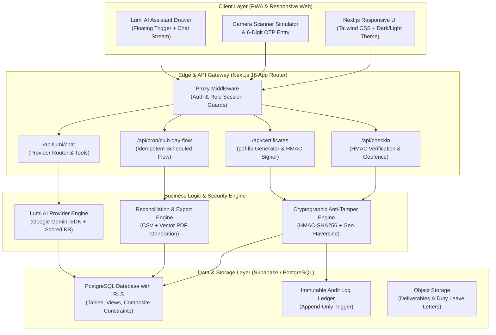
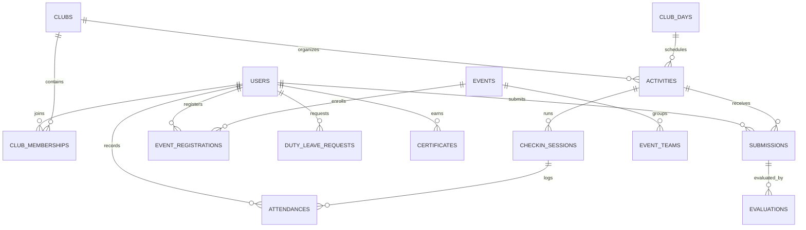

# Track Stack: System Architecture & Technical Design Specification

> [!NOTE]
> **AI-Assisted Development**: Track Stack was built with the assistance of AI (Google Antigravity and Gemini models) by team **Version Controllers** (**Ayush Chauhan** - Team Leader, and **Rishav Ranjan**), defining problem requirements from the Mirai School of Technology (MSOT) brief, establishing data models, reviewing output, and testing continuously.

---

## 1. System Architecture Overview

---

## 2. Relational Data Model

Track Stack's database architecture enforces relational integrity, Row Level Security (RLS), and uniqueness constraints:

### Key Schema Entities:
- **`users`**: Multi-campus user directory (`id`, `campus_id`, `role`, `email`, `student_id`).
- **`clubs`**: 4 parent societies and 6 joinable clubs (`parent_club_id`, `category`, `capacity`).
- **`club_memberships`**: Student club enrollments governed by a trigger-enforced **2-club limit**.
- **`club_days` & `activities`**: Saturday Club Day sessions with advisor lifecycle approvals.
- **`checkin_sessions` & `attendances`**: Live rotating check-ins with geofence and proxy flags.
- **`submissions` & `evaluations`**: Versioned student deliverables with weighted 0–10 rubrics.
- **`events` & `event_registrations`**: Hackathons/conferences with atomic team uniqueness.
- **`certificates`**: Signed records embedding verifiable cryptographic signatures.
- **`audit_log`**: Immutable audit records storing before/after states for all sensitive operations.
- **`lumi_faq`**: Knowledge-base dataset indexed for semantic query matching.

---

## 3. Check-In Security & Anti-Proxy Engine

To prevent attendance fraud in college environments, Track Stack deploys five synchronized security controls:

1. **Rotating QR Cryptographic Signature**:
   - The coordinator run deck displays a fresh QR token every 25 seconds.
   - Token structure: `ts_chk_<base64Payload>.<hmacSignature>`.
   - The HMAC binds `sessionId`, `clubDayId`, `exp`, `salt`, and rotating OTP with `HMAC-SHA256`.
   - Tokens older than 25 seconds (with 2-second network skew grace) are permanently rejected.
2. **Haversine Geofencing**:
   - Compares the student's browser GPS against campus coordinates ($\text{lat}=28.5355, \text{lon}=77.3910$).
   - Students outside the configured campus radius (default: 300m) are blocked outright.
3. **Hardware Device Fingerprinting**:
   - Combines user-agent, viewport resolution, and color depth into an 8-character hex digest.
   - When multiple student IDs check in from the same hardware digest on a single session, `device_reuse_flag = true` is flagged for coordinator review.
4. **Idempotency & Database Atomicity**:
   - A composite unique constraint `UNIQUE(session_id, user_id)` guarantees that concurrent scan requests for the same student cannot create duplicate records.
5. **Mandatory Correction Auditing**:
   - Any manual attendance modification by a coordinator strictly requires a non-empty textual justification, recording the delta in the immutable `audit_log`.

---

## 4. Anti-Tamper Certificate Verification Design

1. **Canonical Digest Generation**:
   - Canonical payload string: `id|userId|eventId|type|issueDate|signatoryName`.
2. **Cryptographic HMAC Signing**:
   - Digest signed using server-side `HMAC-SHA256(canonicalPayload, HMAC_SECRET)`.
   - The resulting 64-character hex signature is persisted to the database and embedded in the PDF metadata as well as a scannable verification QR code.
3. **Public Dynamic Verification (`/verify/[certificateId]`)**:
   - When scanned or entered on the public verification page, the server fetches canonical database values and recomputes the HMAC signature.
   - **Verification State Engine**:
     - $\text{Calculated} == \text{Stored Signature} \land \text{Status} \neq \text{'revoked'} \implies \mathbf{VALID}$
     - $\text{Status} == \text{'revoked'} \implies \mathbf{REVOKED}$
     - $\text{Calculated} \neq \text{Stored Signature} \lor \text{Data Altered} \implies \mathbf{INVALID-TAMPERED}$

---

## 5. Lumi AI Assistant Architecture

- **Provider Abstraction**: Decoupled `LumiProvider` interface supporting Google Gemini Flash with zero client exposure of API keys.
- **Local Scored Fallback**: When offline or if API quotas are reached, a local scoring engine matches queries against 60+ curated college Q&As across 8 categories.
- **Role & Path Context Injection**: System prompts dynamically incorporate the user's active role (`student`, `student_coordinator`, `faculty_advisor`, `campus_manager`, `admin`) and URL path (`/checkin`, `/transcript`).
- **Safe Read-Only RLS Tools**: Exposes isolated tool functions:
  - `get_my_clubs`: Fetch student's joined clubs and enrollment capacity.
  - `get_my_attendance_summary`: Aggregate attendance percentages.
  - `get_my_pending_deliverables`: Check assignment deadlines.
  - `get_my_certificates`: Retrieve earned verification links.
  - `get_my_duty_leave`: Inspect approval status and download letter.
- **Multilingual Tokenizer**: Fluent parsing and response generation in English, Hindi, and Hinglish.

---

## 6. Scalability & High-Concurrency Notes

1. **Sub-Second Response Under 500+ Concurrent Scans**:
   - B-Tree compound index on `attendances(session_id, user_id)` allows instant composite lookups ($O(\log N)$).
   - In-memory cryptographic signature parsing rejects invalid QR scans before triggering database writes.
2. **Connection Pooling via Supavisor**:
   - Directs high-concurrency traffic through transaction pooler port `6543`, enforcing a 5-second statement timeout to prevent connection starvation.
3. **Stateless Serverless Execution**:
   - Next.js route handlers are stateless, enabling elastic horizontal scaling on Vercel Edge/Serverless compute.
4. **Export Reconciliation**:
   - Monthly reports compute deterministic aggregates that mathematically reconcile with raw transactional tables with 0% variance.
